# 🌱 FarmGuard: Irrigation Outcome Assurance

> **Một lệnh tưới chỉ thành công khi dữ liệu cảm biến chứng minh nước đã tới đất, chứ không phải khi thiết bị trả “OK”.**

Bài dự thi **MongoDB × Datadog Mini Hackathon 2026** của **Đội TENET**.

FarmGuard phát hiện lỗi tưới **“im lặng”**: bộ điều khiển báo đã bật bơm nhưng nước không tới ruộng. Hệ thống tự mở incident, cảnh báo qua Datadog, và chỉ đóng incident khi dữ liệu trong **MongoDB Time Series** chứng minh ruộng đã được tưới. FarmGuard chạy được với **ESP32 thật ngoài ruộng** lẫn simulator.


<p align="center">
  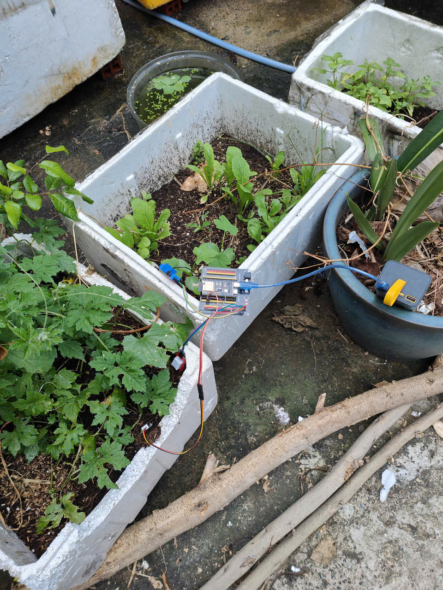<br>
  <sub>Phần cứng thật: ESP32-S3, cảm biến và relay lắp ngoài bồn rau</sub>
</p>

<p align="center">
  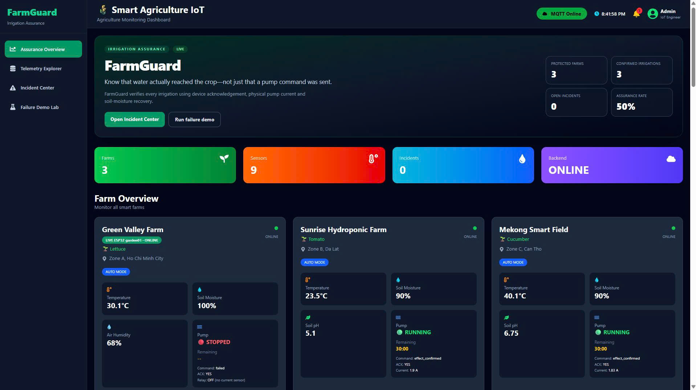<br>
  <sub>Trang tổng quan: <b>Green Valley Farm</b> nhận dữ liệu thật từ ESP32 <code>garden01</code> (nhãn <i>LIVE ESP32 · ONLINE</i>), hai farm còn lại chạy simulator</sub>
</p>

| | |
|---|---|
| **Video demo** | _TODO: link YouTube/Drive_ · kịch bản: [docs/DEMO_VIDEO_SCRIPT.md](docs/DEMO_VIDEO_SCRIPT.md) |
| **Slide** | _TODO: link PDF_ |
| **Chạy bằng Docker** | [docs/DOCKER.md](docs/DOCKER.md) |
| **Phần cứng ESP32** | [docs/HARDWARE.md](docs/HARDWARE.md) |
| **Thiết kế hệ thống** | [docs/HACKATHON_SYSTEM_DESIGN.md](docs/HACKATHON_SYSTEM_DESIGN.md) · [docs/MVP_RUNBOOK.md](docs/MVP_RUNBOOK.md) |

---

## Mục lục

1. [Đội thi](#1-đội-thi)
2. [Vấn đề](#2-vấn-đề)
3. [Giải pháp](#3-giải-pháp)
4. [Phần cứng thật](#4-phần-cứng-thật)
5. [Kiến trúc hệ thống](#5-kiến-trúc-hệ-thống)
6. [⭐ MongoDB Time Series: trái tim dữ liệu](#6--mongodb-time-series-trái-tim-dữ-liệu)
7. [⭐ Datadog: phát hiện, điều tra, xử lý](#7--datadog-phát-hiện-điều-tra-xử-lý)
8. [Sự cố được trình diễn](#8-sự-cố-được-trình-diễn)
9. [Cài đặt và chạy](#9-cài-đặt-và-chạy)
10. [Kiểm thử](#10-kiểm-thử)
11. [Cấu trúc repository](#11-cấu-trúc-repository)
12. [Khai báo](#12-khai-báo)
13. [Giới hạn và hướng phát triển](#13-giới-hạn-và-hướng-phát-triển)

---

## 1. Đội thi

**Đội TENET**

| Thành viên | Vai trò |
|---|---|
| Nguyễn Thành Kiệt | Trưởng nhóm, người liên hệ chính |
| Võ Mai Hoàng Tiến | Thành viên |

---

## 2. Vấn đề

Hệ thống tưới tự động thường coi **“đã gửi lệnh, đã nhận ACK”** là **“đã tưới”**. Nhưng ACK chỉ chứng minh *bộ điều khiển còn sống*. Relay vẫn đóng được trong khi:

- mô-tơ mất pha hoặc cháy cuộn dây;
- bơm nằm ngoài bể, bể hết nước, ống bị tuột;

và dashboard vẫn xanh. Nông dân chỉ phát hiện khi ra đồng, có khi nhiều giờ sau, lúc cây đã héo.

Cảnh báo kiểu `độ ẩm < 50%` báo **triệu chứng**, không báo **nguyên nhân**: nó không phân biệt được “chưa tưới” với “đã ra lệnh tưới nhưng nước không tới”.

## 3. Giải pháp

FarmGuard định nghĩa lại thế nào là một lệnh tưới **thành công**. Phải có đủ 3 bằng chứng, và cả 3 đều được kiểm tra bằng **aggregation trên MongoDB Time Series**:

| # | Bằng chứng | Nguồn dữ liệu |
|---|---|---|
| 1 | **ACK**: bộ điều khiển xác nhận | `pump/state` từ ESP32, hoặc ACK của simulator |
| 2 | **Bơm thật sự chạy** | Dòng điện > 0.1 A (simulator) hoặc relay ON (ESP32) |
| 3 | **Nước tới đất**: độ ẩm đất tăng lại | Series `humidity` trong `telemetry_ts` |

| Incident | Khi nào mở | Khi nào đóng |
|---|---|---|
| `pump_no_effect` (**silent failure**) | Có ACK, nhưng trong cửa sổ sau ACK bơm không tạo ra kết quả (0 A, hoặc relay ON 60 s mà độ ẩm không tăng ≥ 3 điểm) | Telemetry chứng minh bơm chạy **và** độ ẩm tăng |
| `pump_ack_timeout` | Lệnh đã gửi nhưng không có ACK trong thời hạn | Có ACK và kết quả vật lý được chứng minh |
| ESP32 offline | 15 s không có telemetry | Thiết bị gửi dữ liệu trở lại |

Mọi bản ghi liên quan (lệnh, telemetry, incident, log, Datadog event) mang chung một **`correlationId`**, nên từ một alert có thể lần ngược tới đúng dữ liệu gốc.

---

## 4. Phần cứng thật

ESP32-S3 đọc cảm biến mỗi **2.5 giây**, tự tưới ở chế độ AUTO, và gửi dữ liệu qua **MQTT** trong mạng LAN. Firmware nằm ở [IOT/SmartAgriculture/](IOT/SmartAgriculture/).

<table>
  <tr>
    <td align="center">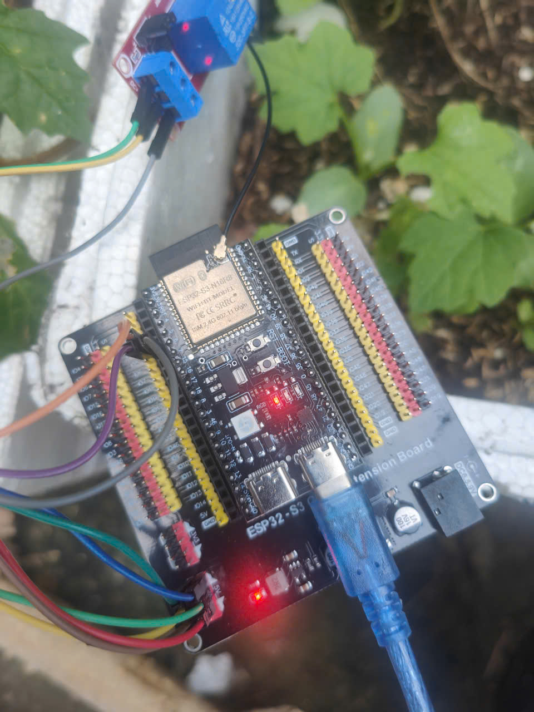<br><sub>ESP32-S3 + board mở rộng GPIO</sub></td>
    <td align="center">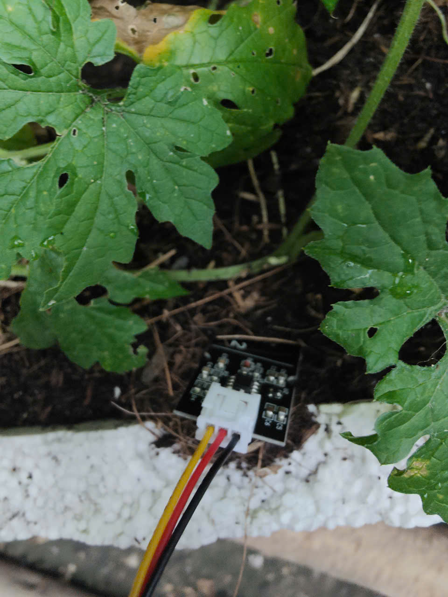<br><sub>Cảm biến ẩm đất điện dung v1.2</sub></td>
    <td align="center">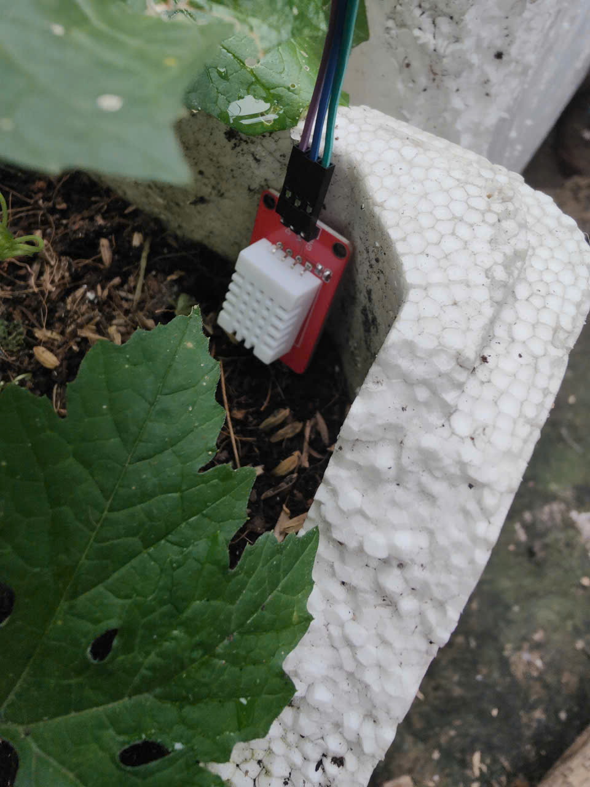<br><sub>DHT22: nhiệt độ, độ ẩm không khí</sub></td>
  </tr>
  <tr>
    <td align="center">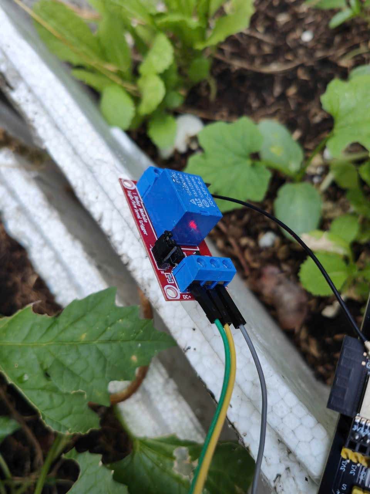<br><sub>Relay 1 kênh điều khiển bơm</sub></td>
    <td align="center">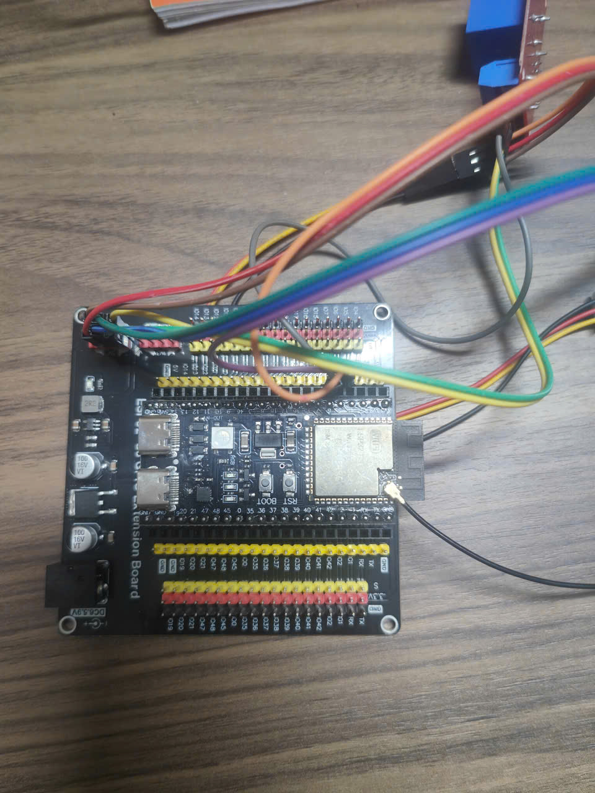<br><sub>Đấu dây trên bàn thử</sub></td>
    <td align="center">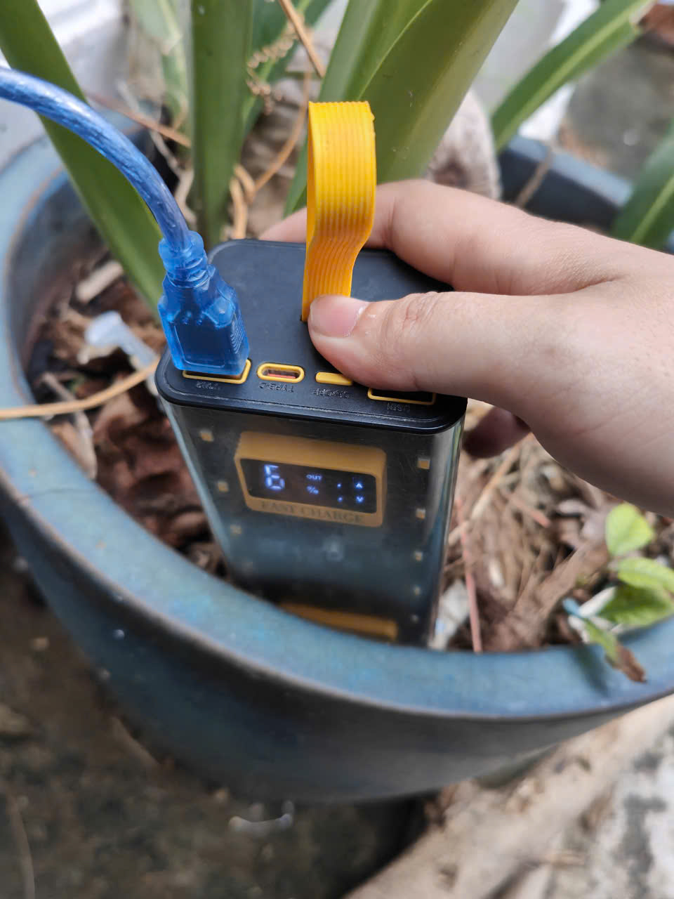<br><sub>Cấp nguồn bằng pin dự phòng</sub></td>
  </tr>
</table>

Toàn bộ ảnh phần cứng và ảnh chụp màn hình nằm trong thư mục [image/](image/).

### Dữ liệu thật từ ESP32

Board `garden01` được gắn với farm **Green Valley Farm** (`HARDWARE_DEVICES=garden01=FARM-001`). Simulator bỏ qua farm này, nên mọi số liệu của nó đều đo từ cảm biến thật.

<p align="center">
  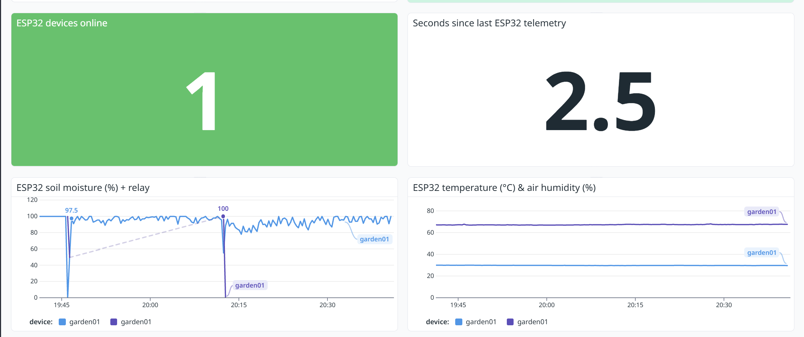<br>
  <sub>Datadog nhận dữ liệu realtime: <b>1 ESP32 online</b>, lần gửi cuối cách <b>2,5 s</b>, độ ẩm đất kèm trạng thái relay, nhiệt độ và độ ẩm không khí của <code>garden01</code></sub>
</p>

<table>
  <tr>
    <td align="center" width="50%">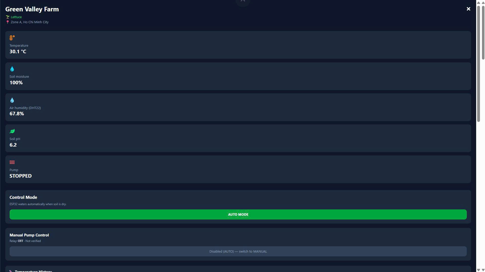<br><sub>Chi tiết farm: số đo DHT22, chế độ AUTO, trạng thái relay</sub></td>
    <td align="center" width="50%">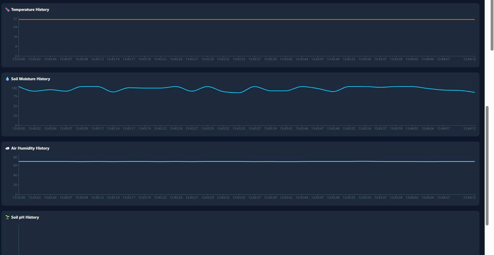<br><sub>Lịch sử cảm biến theo từng lần gửi 2,5 s</sub></td>
  </tr>
</table>

### Sơ đồ đấu dây

<p align="center">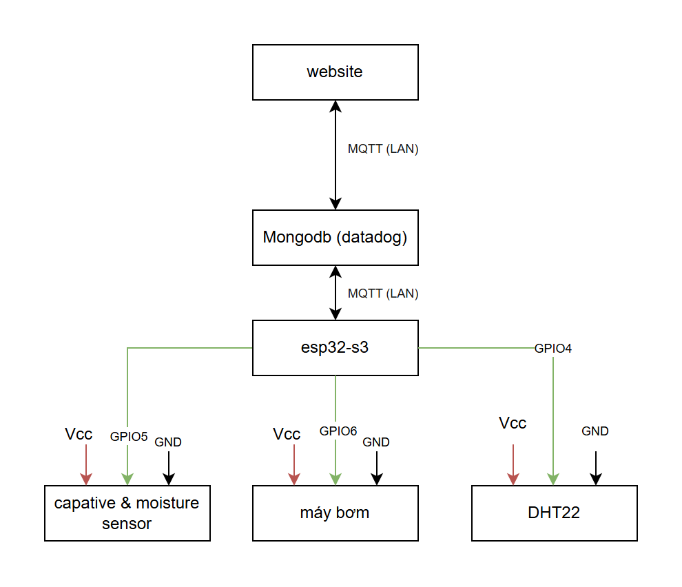</p>

| Linh kiện | Chân ESP32-S3 | Vai trò |
|---|---|---|
| Cảm biến ẩm đất điện dung v1.2 | GPIO5 (ADC, trung bình 20 mẫu) | Độ ẩm đất % (hiệu chỉnh khô 2038 / ướt 1090) |
| DHT22 | GPIO4 | Nhiệt độ, độ ẩm không khí |
| Relay → máy bơm | GPIO6 | Bật/tắt bơm |

### Logic firmware

<p align="center">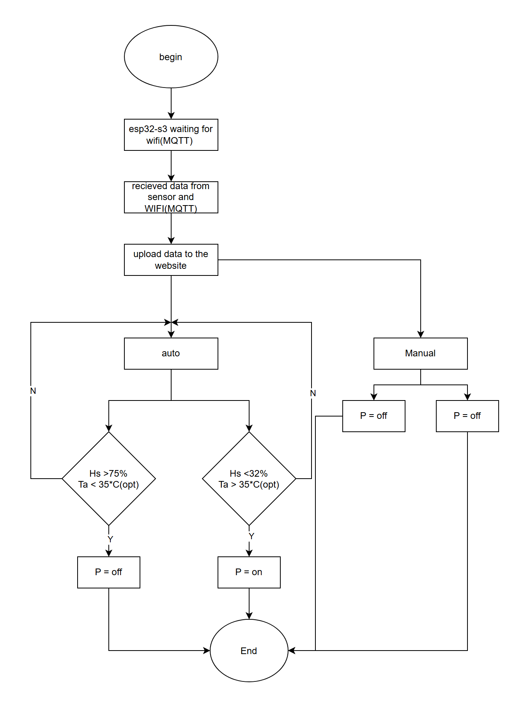</p>

Ở chế độ AUTO, firmware bật bơm khi đất < 35% và tắt khi đất ≥ 75%, đồng thời ngắt bơm khi nhiệt độ > 38 °C. Việc tưới chạy **cục bộ trên ESP32**, nên vẫn hoạt động khi mất WiFi.

### Giao thức MQTT

| Topic | Hướng | Payload |
|---|---|---|
| `smartgarden/garden01/telemetry` | ESP32 → | `{"temperature":27.1,"humidity":61.0,"soil":42.5,"pump":true}` mỗi 2.5 s |
| `smartgarden/garden01/pump/state` | ESP32 → | `ON` / `OFF` |
| `smartgarden/garden01/pump/command` | → ESP32 | `ON` / `OFF` |
| `smartgarden/garden01/mode/command` | → ESP32 | `AUTO` / `MANUAL` |

Board **không có cảm biến dòng điện**, nên với phần cứng thật FarmGuard dùng bằng chứng: **relay ON + độ ẩm đất phải tăng**. Cách demo đơn giản nhất: nhấc bơm ra khỏi bể nước. Chi tiết ở [docs/HARDWARE.md](docs/HARDWARE.md).

---

## 5. Kiến trúc hệ thống

<p align="center">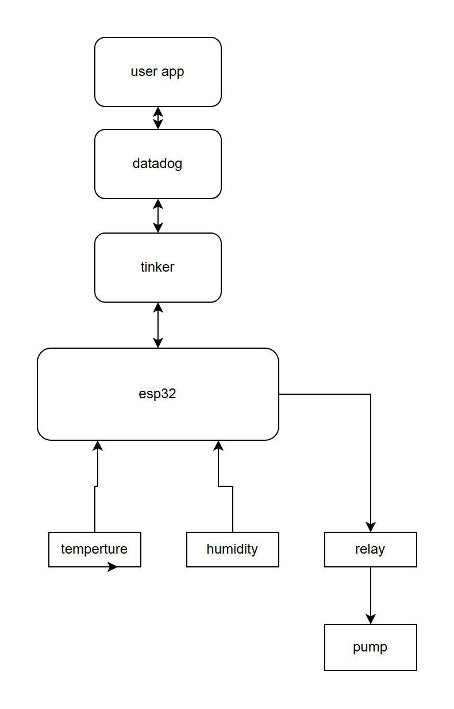</p>

Chi tiết các thành phần:

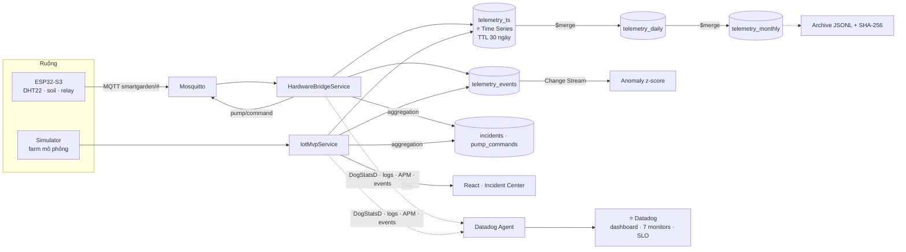

| Thành phần | Công nghệ |
|---|---|
| Thiết bị | ESP32-S3, DHT22, cảm biến ẩm đất điện dung, relay; firmware Arduino C++ |
| Truyền tin | MQTT (Eclipse Mosquitto) |
| Backend | Node.js, Express, Mongoose, `mqtt`, `dd-trace` |
| Dữ liệu | **MongoDB 7: Time Series collection**, Change Streams, TTL, aggregation pipeline |
| Quan sát | **Datadog**: DogStatsD metrics, Log Management, APM, Events, Anomaly Detection, SLO |
| Giao diện | React 19, Vite, Tailwind CSS, Server-Sent Events |
| Triển khai | Docker Compose (MongoDB, Mosquitto, backend, frontend nginx, Datadog Agent) |

---

## 6. ⭐ MongoDB Time Series: trái tim dữ liệu

Mọi số đo, từ simulator hay từ ESP32, đều được ghi vào **một Time Series collection duy nhất**: `telemetry_ts`. Phát hiện sự cố, chứng minh phục hồi, biểu đồ và KPI đều đọc từ đây.

### 6.1 Thiết kế collection

```js
// backend/src/models/Telemetry.js
{
  collection: 'telemetry_ts',
  timeseries: {
    timeField: 'capturedAt',     // thời điểm đo
    metaField: 'meta',           // { farmId, farmCode, deviceId, sensorType }
    granularity: 'seconds'       // khớp nhịp lấy mẫu 2–2.5 s
  },
  expireAfterSeconds: 60 * 60 * 24 * 30   // TTL: dữ liệu thô tự hết hạn sau 30 ngày
}
// + index phụ: { 'meta.farmId': 1, 'meta.sensorType': 1, capturedAt: -1 }
```

| Quyết định | Lý do |
|---|---|
| **Một document = một số đo** (`value`, `unit`) | Thêm loại cảm biến (`pump_current`, `pump_relay`, `air_humidity`) không phải đổi schema |
| **`metaField` = farm + thiết bị + loại cảm biến** | MongoDB gom các số đo cùng một chuỗi vào chung bucket, nên đọc theo chuỗi rất nhanh và nén tốt |
| **`granularity: 'seconds'`** | Đúng với nhịp gửi 2–2.5 s của ESP32 và simulator, không gom bucket quá rộng hay quá hẹp |
| **TTL 30 ngày** | Tầng “nóng” không phình vô hạn; dữ liệu cũ được rollup sang tầng ấm bằng `npm run data:cycle` trước khi hết hạn |
| **`messageId`, `correlationId`, `source`, `quality`** | Chống ghi trùng, nối số đo với lệnh/incident, phân biệt `simulator` / `mqtt` / `hardware` |
| **Index phụ `(farmId, sensorType, capturedAt)`** | Phục vụ đúng mẫu truy vấn của bộ phát hiện: “chuỗi X của farm Y, từ thời điểm Z” |

**Số đo thực tế**, đọc từ `collStats` qua `GET /api/iot/telemetry/storage` và hiển thị ngay trong app:

| Thời điểm | Số đo | Bucket | Số đo / bucket | Dữ liệu logic | Đã cấp phát trên đĩa |
|---|---|---|---|---|---|
| 12/11/2026 (Docker, có ESP32 thật) | **60.632** | **96** | ≈ **632** | 3,52 MiB | 2,95 MiB |
| 05/11/2026 (máy dev, chạy simulator lâu) | **443.346** | **1.292** | ≈ **343** | 17,46 MiB | 3,05 MiB |

Hàng trăm số đo của cùng một chuỗi được gom vào một bucket. Dung lượng cấp phát có tính cả không gian trống, nên không phải tỉ lệ nén chính xác.

<p align="center">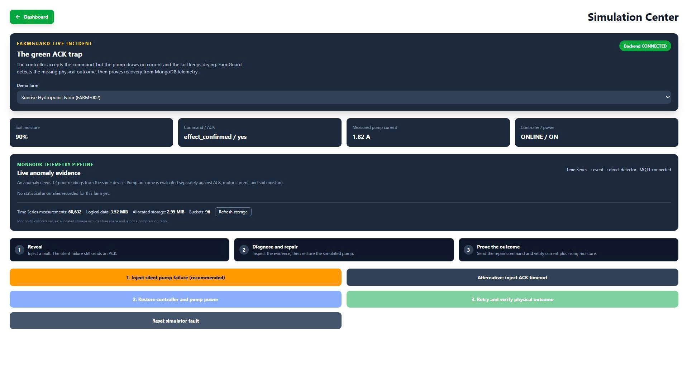<br><sub>Simulation Center đọc <code>collStats</code> của <code>telemetry_ts</code>: 60.632 số đo trong 96 bucket</sub></p>

### 6.2 Vòng đời dữ liệu: nóng → ấm → lạnh → lưu trữ

| Tầng | Collection | Giữ trong | Cách tạo |
|---|---|---|---|
| 🔥 Nóng | `telemetry_ts` (**Time Series**) | 30 ngày (TTL) | Ghi trực tiếp từ MQTT, ESP32, simulator |
| 🌤 Ấm | `telemetry_daily` | 400 ngày (TTL index) | Aggregation → **`$merge`**, theo ngày giờ Việt Nam |
| ❄️ Lạnh | `telemetry_monthly` | Lâu dài | Rollup từ tầng ấm → **`$merge`** |
| 📦 Lưu trữ | File JSONL (Extended JSON) | Ngoài DB | Kèm manifest **SHA-256** để kiểm chứng |

API xu hướng (`GET /api/iot/telemetry/trend?period=day|month|year`) **tự chọn tầng** phù hợp: dữ liệu trong 30 ngày đọc từ Time Series, xa hơn thì đọc từ tầng ấm hoặc lạnh. Trang **Telemetry Explorer** dùng API này và ghi rõ mỗi điểm lấy từ tầng nào.

<p align="center">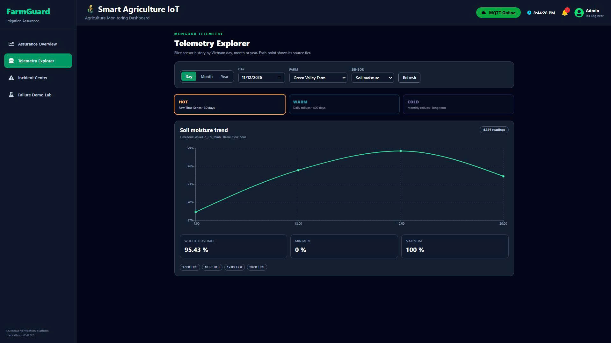<br><sub>Telemetry Explorer: độ ẩm đất của ESP32 trong ngày (4.397 số đo). Mỗi điểm ghi tầng nguồn, ở đây là <b>HOT</b>, tức Time Series</sub></p>

### 6.3 Aggregation trên Time Series: mỗi pipeline gắn với một bước xử lý sự cố

| Bước | Pipeline | Ở đâu |
|---|---|---|
| **Phát hiện** silent failure (simulator) | `$match` cửa sổ sau ACK → `$sort` → `$group` theo `sensorType` (`$first`, `$last`, `$max`) | `IotMvpService.maybeDetectSilentFailure` |
| **Phát hiện** silent failure (ESP32) | `$match` độ ẩm từ lúc relay ON → `$group` + `$push` → `$slice` trung bình 3 mẫu đầu và 3 mẫu cuối, chống nhiễu cảm biến | `HardwareBridgeService.evaluateOutcome` |
| **Chứng minh** phục hồi | **`$setWindowFields`** chia chuỗi thành các pha *before / during / after* và tính độ dốc độ ẩm từng pha | `IotMvpService.getIncidentEvidence` |
| **Đo lường** | **`$dateDiff`** (MTTD, MTTR) → **`$facet`** (tổng quan / theo loại / theo farm) → **`$lookup`** `farms` | `IotMvpService.getIncidentKpis` |
| **Lưu trữ** | Rollup theo ngày, tháng → **`$merge`** | `TelemetryRetentionService` |

### 6.4 Pipeline realtime với Change Streams

Mỗi lô số đo được ghi thêm một sự kiện vào `telemetry_events`. Collection này được theo dõi bằng **Change Streams**: mỗi lô mới được so với **12 mẫu gần nhất** của cùng thiết bị (z-score), bất thường được lưu vào `telemetry_anomalies` kèm bằng chứng. Cặp `(farmId, messageId)` có unique index nên tin MQTT gửi lặp lại không bị ghi trùng. Nếu MongoDB không chạy replica set, pipeline tự chuyển sang xử lý trực tiếp.

<p align="center">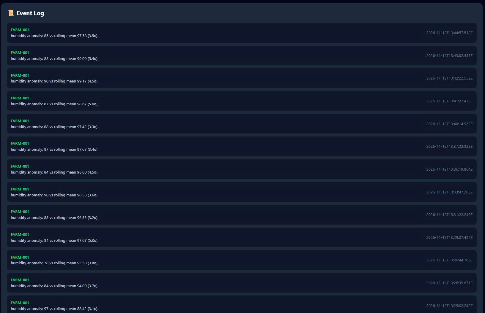<br><sub>Anomaly trên dữ liệu thật của ESP32 (FARM-001): mỗi dòng ghi giá trị đo, trung bình trượt và độ lệch theo σ</sub></p>

### 6.5 Các collection khác

| Collection | Vai trò | Điểm đáng chú ý |
|---|---|---|
| `incidents` | Vòng đời sự cố và bằng chứng phục hồi | **Partial unique index**: mỗi farm chỉ có 1 incident đang mở cho mỗi loại, kể cả khi restart; `impactStartedAt` để tính MTTD |
| `pump_commands` | Lệnh, ACK, idempotency key | Unique `idempotencyKey`; lệnh sửa dùng key mới nhưng cùng `correlationId` |
| `telemetry_events` | Hộp thư sự kiện cho Change Streams | TTL 24 giờ, unique `(farmId, messageId)` |
| `telemetry_anomalies` | Bằng chứng bất thường | Rolling mean, độ lệch chuẩn, z-score |
| `farms`, `sensors` | Cấu hình farm, ngưỡng, giá trị mới nhất | |

**Công cụ dữ liệu:** `npm run data:validate` kiểm tra cấu hình Time Series và TTL. `npm run data:estimate` lập kế hoạch bộ dữ liệu tổng hợp khoảng 100 GiB (2.500 farm × 4 chuỗi × 10 s) để thử tải. `npm run data:cycle` chạy rollup và lưu trữ.

---

## 7. ⭐ Datadog: phát hiện, điều tra, xử lý

Datadog nhận **metrics, logs, traces và events** từ backend qua Datadog Agent. Bốn loại tín hiệu nối với nhau bằng `correlationId`, `farm` và `trace_id`.

```
Monitor ALERT ──link──► Dashboard (lọc sẵn theo farm) ──► Logs Explorer (@correlationId)
                                                              │ trace_id
                                                              ▼
                                         APM trace farmguard.simulator.tick / hardware.telemetry
                                                   └─ span MongoDB của đúng lần xử lý đó
```

### 7.1 Năng lực đã dùng

| Năng lực | Triển khai |
|---|---|
| **Metrics** (DogStatsD) | `smartfarm.soil_moisture.percent`, `pump.current_amp`, `pump.relay_on`, `irrigation.outcome_missing`, `incident.open`, `command.ack_latency_ms`, `command.{effect_confirmed,timeout}`, `incident.{time_to_detect,time_to_resolve,unirrigated}_seconds`, `device.{online,last_seen_seconds}`, `telemetry.{received,anomaly}`, `sensor.read_error` |
| **Log Management** | Log JSON có cấu trúc (`event`, `farm`, `correlationId`, `incidentId`, `deviceId`) → file → Agent |
| **APM** | `dd-trace` tự instrument Express và MongoDB; span riêng `farmguard.simulator.tick` và `farmguard.hardware.telemetry`; log được gắn `dd.trace_id` |
| **Events** | Mỗi incident mở/đóng tạo một Datadog Event (`source:farmguard`), hiện dạng overlay trên biểu đồ |
| **Anomaly Detection** | Monitor `anomalies()` trên độ ẩm đất của từng farm |
| **SLO** | *Irrigation commands with proven physical outcome*: **95% / 7 ngày** |

### 7.2 Bảy monitor, tất cả tạo bằng code

`npm run datadog:provision` tạo hoặc cập nhật dashboard, monitor và SLO. Lệnh này chạy lại nhiều lần vẫn an toàn (xem [provisionDatadog.js](backend/src/scripts/provisionDatadog.js)).

| Monitor | Tín hiệu | Năng lực |
|---|---|---|
| ACK received but irrigation outcome missing | `outcome_missing` = 1 theo farm | Metrics |
| Pump command ACK timeout | `command.timeout` > 0 trong 5 phút | Metrics |
| Telemetry pipeline stalled | Không có số đo trong 5 phút, báo cả khi mất dữ liệu | Metrics |
| **ESP32 device offline** | `device.online` < 1 trong 2 phút | Metrics (phần cứng thật) |
| Soil moisture anomaly | `anomalies(soil_moisture)` | Anomaly Detection |
| Backend pipeline errors | Log `status:error` theo `@event` | Log Management |
| Simulator tick slow | p95 trace > 2 s | APM |

Mỗi tin nhắn cảnh báo có link tới dashboard đã lọc theo farm và tới truy vấn Logs Explorer tương ứng.

### 7.3 Dashboard

Dashboard *FarmGuard | Irrigation Outcome Assurance* có 24 widget, chia thành các nhóm:

- **Luồng xử lý sự cố:** ghi chú các bước detect → investigate → respond, trạng thái các monitor;
- **KPI:** MTTD, MTTR, số farm đang có silent failure, số lần ACK timeout;
- **Telemetry:** độ ẩm kèm dải anomaly, dòng điện bơm, kết quả lệnh, lưu lượng số đo;
- **Live ESP32 hardware:** số thiết bị online, thời gian từ lần gửi cuối, độ ẩm đất kèm relay, nhiệt độ, độ ẩm không khí, lỗi đọc DHT22;
- **APM và log:** p95 latency, request/lỗi, log stream có cột `correlationId`.

<p align="center">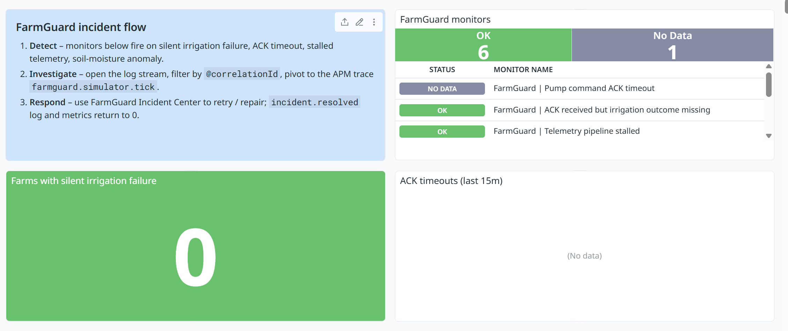<br><sub>Luồng xử lý sự cố, trạng thái các monitor FarmGuard (6 OK), số farm đang có silent failure</sub></p>

<table>
  <tr>
    <td align="center" width="50%">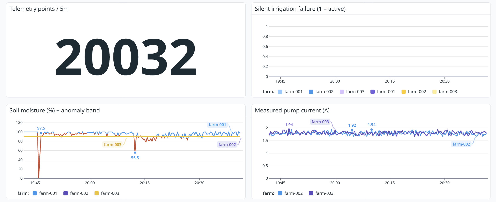<br><sub>Lưu lượng telemetry, độ ẩm kèm dải <b>Anomaly Detection</b>, dòng điện bơm</sub></td>
    <td align="center" width="50%">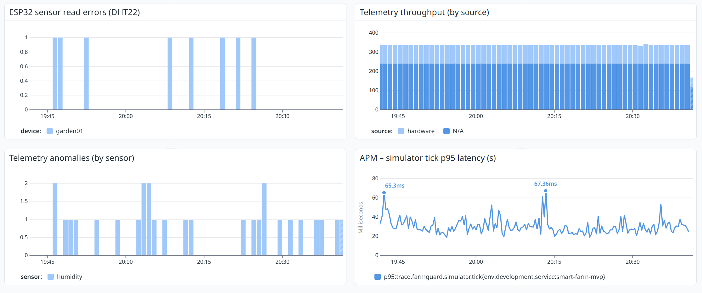<br><sub>Lỗi đọc DHT22, throughput theo nguồn, anomaly, <b>APM</b> p95</sub></td>
  </tr>
  <tr>
    <td align="center">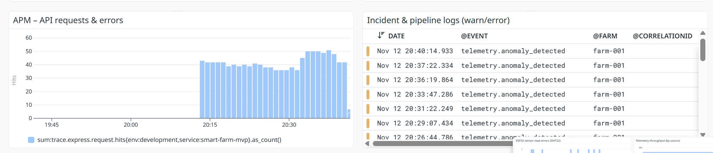<br><sub>Request API (APM) và <b>log stream</b> có cột <code>@event</code>, <code>@farm</code>, <code>@correlationId</code></sub></td>
    <td align="center">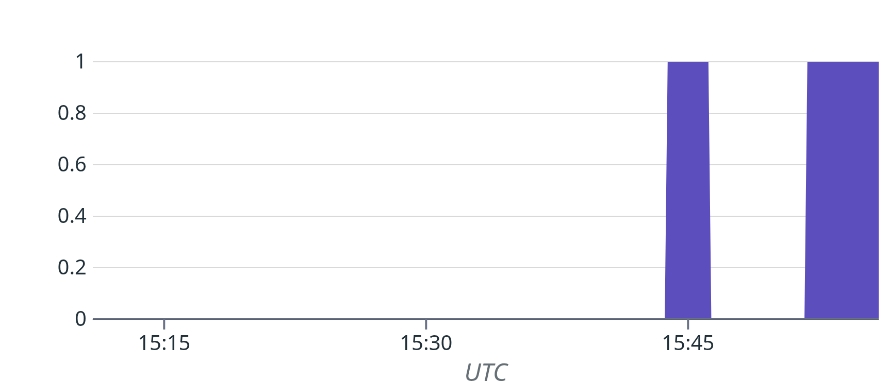<br><sub><code>outcome_missing</code> lên 1 trong mỗi lần silent failure, về 0 khi phục hồi được chứng minh</sub></td>
  </tr>
</table>

---

## 8. Sự cố được trình diễn

### Với phần cứng thật: “Relay bật, ruộng vẫn khô”

1. Đất khô dưới 35%, ESP32 tự bật relay.
2. **Nhấc bơm ra khỏi bể nước.** Relay vẫn ON nhưng độ ẩm đất không tăng.
3. Sau 60 giây, FarmGuard mở incident `pump_no_effect`. Datadog monitor chuyển **Alert**, có event *incident opened* và log `irrigation.outcome_missing`.
4. **Thả bơm lại vào bể.** Độ ẩm tăng ≥ 3 điểm, incident **tự đóng kèm bằng chứng**, monitor về **OK**.

### Với simulator: “ACK xanh, mô-tơ chết”

<p align="center">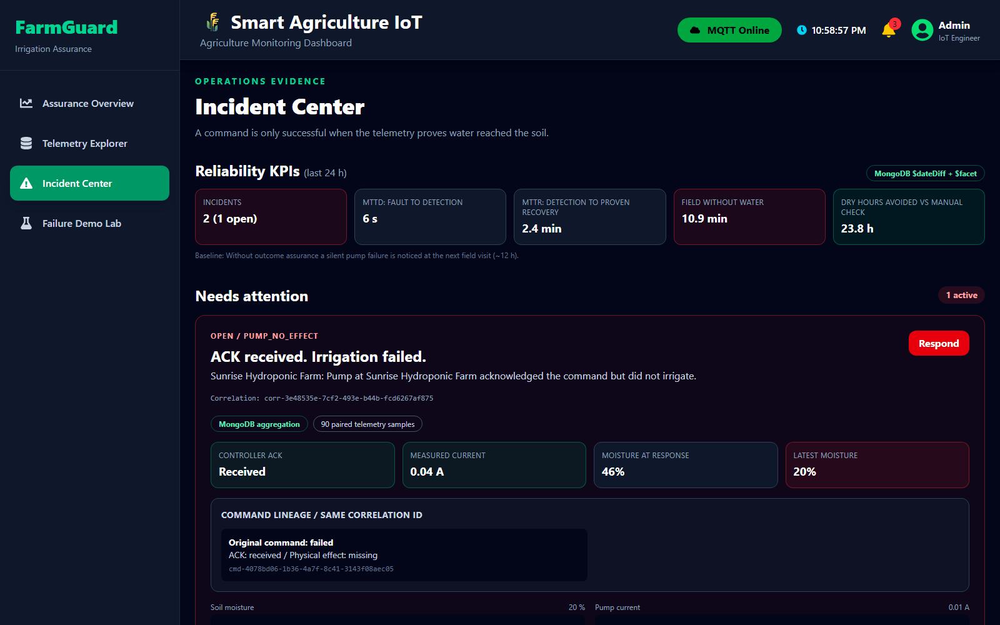<br><sub>Incident Center trong lúc có sự cố: ACK đã nhận nhưng chỉ 0,04 A, độ ẩm 46% → 20%; KPI MTTD/MTTR tính bằng aggregation</sub></p>

1. Ở `/simulation`, bấm **Inject silent pump failure** cho FARM-002: bộ điều khiển vẫn ACK nhưng mô-tơ mất nguồn.
2. **6 giây sau:** incident mở, Datadog **Alert**.
3. Điều tra: alert → dashboard → log theo `correlationId` → trace có span MongoDB.
4. Ở `/incidents`: bằng chứng *ACK received / 0.04 A / độ ẩm giảm*. Khôi phục nguồn rồi gửi lệnh sửa.
5. Có khoảng 1.8 A và độ ẩm tăng thì incident **resolved**.

**Kết quả một lần chạy thật trên máy local (05/11/2026):** MTTD **6 s**, MTTR **144 s** (gồm cả thời gian operator thao tác). Ruộng mất nước **2,5 phút**, so với giả định khoảng **12 giờ** nếu chờ lần ra đồng tiếp theo.

---

## 9. Cài đặt và chạy

### Cách nhanh nhất: Docker

```bash
cp backend/.env.example backend/.env        # Windows: copy backend\.env.example backend\.env
# điền DD_API_KEY, DD_APP_KEY, DD_SITE nếu dùng Datadog

docker compose --env-file backend/.env --profile observability up -d --build
docker compose run --rm backend node src/seeders/seedDatabase.js     # chỉ lần đầu, khi DB trống
docker compose run --rm backend node src/scripts/provisionDatadog.js # tạo dashboard, monitor, SLO
```

Mở **http://localhost:8080** (Swagger API: http://localhost:5000/api/docs). Hướng dẫn đầy đủ, gồm cả Linux và xử lý sự cố: [docs/DOCKER.md](docs/DOCKER.md).

### Kết nối ESP32

1. Thêm vào `backend/.env`:
   ```
   MQTT_BIND=0.0.0.0
   HARDWARE_DEVICES=garden01=FARM-001
   ```
2. Copy `IOT/SmartAgriculture/AppConfig.example.h` thành `AppConfig.h`, điền WiFi và đặt `MQTT_BROKER` là IP LAN của máy chạy Docker, rồi nạp firmware.
3. Kiểm tra: http://localhost:8080/api/iot/hardware phải trả về `"online": true`.

Chưa có board thì dùng trình giả lập nói đúng giao thức firmware:

```bash
docker compose exec -it backend node src/scripts/emulateEsp32.js --url mqtt://mqtt:1883 --no-water
```

### Chạy bằng npm (phát triển)

```bash
docker compose up -d mongodb mqtt
cd backend && npm install && npm run seed && npm run start:apm
cd .. && npm install && npm run dev     # http://localhost:5173
```

---

## 10. Kiểm thử

```bash
cd backend
npm run test:mvp         # end-to-end: ACK timeout + silent failure → phục hồi → KPI MTTD/MTTR
npm run test:pipeline    # MQTT, Time Series, Change Stream, anomaly, chống ghi trùng
npm run test:retention   # rollup ngày/tháng theo giờ Việt Nam, archive có SHA-256
npm run test:hardware    # ESP32: JSON firmware có 'nan', relay, silent failure, phục hồi, offline
npm run test:data        # bộ sinh dataset tổng hợp
```

Các test chạy trên `mongodb-memory-server`, không cần MongoDB thật. Luồng phần cứng đã được thử đầu-cuối qua MQTT thật bằng trình giả lập ESP32: chặn nước thì incident mở, nước chảy lại thì incident đóng, lệnh OFF được ACK sau 62 ms.

---

## 11. Cấu trúc repository

```
├── IOT/SmartAgriculture/        Firmware ESP32-S3 (Arduino C++)
├── image/                       Ảnh phần cứng thật, ảnh chụp app và Datadog
├── backend/
│   ├── src/models/              Telemetry (Time Series), Incident, PumpCommand, ...
│   ├── src/services/            IotMvpService, HardwareBridgeService, TelemetryPipeline/Retention/Trend
│   ├── src/scripts/             provisionDatadog, emulateEsp32, dataset, maintenance
│   ├── src/utils/observability.js   DogStatsD, log JSON, APM, Datadog Events
│   └── src/tests/               5 bộ kiểm thử
├── src/                         Frontend React (Dashboard, Incident Center, Failure Demo Lab)
├── datadog/                     Cấu hình thu log của Datadog Agent
├── thiet_ke_so_do_2/architecture/drawio/   Sơ đồ gốc (so_do, so_do_2, so_do_3)
├── docs/                        DOCKER, HARDWARE, thiết kế, runbook, kịch bản video, ảnh
├── video/farmguard-video/       Video demo dựng bằng Remotion
└── compose.yaml                 MongoDB, Mosquitto, backend, frontend, Datadog Agent
```

---

## 12. Khai báo

### Thành phần tái sử dụng

| Thành phần | Nguồn | Ghi chú |
|---|---|---|
| Nền tảng Smart Agriculture IoT gốc (CRUD farm/sensor/user, Swagger, dashboard) | Do đội tự viết **trước** giai đoạn build (07/2026) | Mô tả ở [docs/LEGACY_PLATFORM.md](docs/LEGACY_PLATFORM.md); FarmGuard được xây trên nền này |
| Mẫu pipeline MQTT → Change Stream → anomaly | Tham khảo demo “Leafy” của MongoDB và tài liệu *Time Series Workshop* (`Time_Series_Workshop_MongoDB_v4.pptx.pdf`) | Chỉ tham khảo thiết kế; code do đội tự viết |
| Thư viện mã nguồn mở | Express, Mongoose, React, Vite, Tailwind CSS, `dd-trace`, `mqtt`, Remotion, PubSubClient, DHT sensor library | Theo license của từng gói |
| Docker images | `mongo:7`, `eclipse-mosquitto:2`, `gcr.io/datadoghq/agent:7`, `node:22-alpine`, `nginx` | |

**Phần làm trong giai đoạn hackathon:** toàn bộ luồng FarmGuard (outcome assurance, incident, KPI), Time Series và vòng đời dữ liệu, bridge phần cứng ESP32, toàn bộ phần Datadog (metrics, logs, APM, events, monitor, SLO, dashboard), trang `/incidents`, Docker, kiểm thử và tài liệu.

### Dataset

**Chỉ dùng dữ liệu tổng hợp và dữ liệu đo từ phần cứng của đội.** Simulator và [generateTelemetryDataset.js](backend/src/scripts/generateTelemetryDataset.js) sinh dữ liệu có seed, tái lập được. Không dùng dữ liệu production hay dữ liệu cá nhân.

### Công cụ AI

| Công cụ | Dùng cho |
|---|---|
| Claude Code (Anthropic) | Đánh giá theo tiêu chí, Datadog provisioning, KPI MTTD/MTTR, bridge phần cứng ESP32, Docker, video Remotion, tài liệu |
| | |

---

## 13. Giới hạn và hướng phát triển

- **Chưa đo dòng điện trên phần cứng thật.** Hiện kết quả tưới được chứng minh bằng độ ẩm đất. Bước tiếp theo là gắn ACS712 hoặc SCT-013 để phân biệt “mô-tơ không quay” với “không có nước”.
- **Bước xử lý còn do người thực hiện.** Hướng tới tự chuyển sang bơm hoặc van dự phòng, và cảnh báo qua Zalo/Telegram bằng Datadog webhook.
- **Ngưỡng phát hiện còn cố định** (0.1 A, +3 điểm độ ẩm trong 60 s). Hướng tới học ngưỡng riêng theo farm và mùa vụ từ chính dữ liệu Time Series.
- **Firmware:** nên thêm MQTT Last Will để báo offline ngay khi mất điện, và chỉ gửi `pump/state` khi trạng thái thay đổi.

---

<p align="center"><b>Đừng tin ACK. Hãy tin dữ liệu.</b><br><sub>FarmGuard · Đội TENET · MongoDB × Datadog Mini Hackathon 2026</sub></p>
