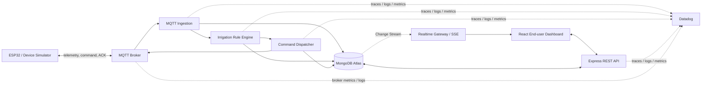

# FarmGuard — Smart Farm IoT có khả năng tự phát hiện và xử lý sự cố tưới

> **MVP hiện tại:** kịch bản chính là lỗi âm thầm: thiết bị ACK nhưng bơm không
> có dòng điện và độ ẩm đất tiếp tục giảm. MongoDB telemetry phát hiện sự cố và
> chứng minh phục hồi; lệnh sửa chữa dùng command ID và idempotency key mới,
> cùng correlation ID với lệnh ban đầu. Kịch bản ACK timeout vẫn có để so sánh.
> Các mục bên dưới là bản thiết kế ban đầu; xem [MVP_RUNBOOK.md](MVP_RUNBOOK.md)
> để chạy và trình diễn phiên bản đã triển khai. Datadog cần tài khoản trial/key
> trước khi tạo dashboard và monitor thật.

## 1. Product story

### Câu chuyện một câu

FarmGuard không chỉ ra lệnh bật máy bơm; hệ thống **chứng minh nước thật sự đã được tưới** và cảnh báo trước khi cây trồng bị ảnh hưởng nếu lệnh điều khiển không đến được thiết bị.

### Nhân vật và vấn đề

Chị Lan quản lý nhiều khu trồng cà chua từ xa. Vào một buổi trưa nóng, độ ẩm đất tại Farm B giảm xuống dưới ngưỡng 45%. Hệ thống tự động phát lệnh bật bơm. Dashboard cũ đổi trạng thái thành `ON` ngay khi lệnh được gửi, nhưng bộ điều khiển bơm đang mất kết nối và không hề thực thi lệnh. Người dùng nhìn thấy màu xanh và nghĩ rằng cây đang được tưới, trong khi độ ẩm vẫn tiếp tục giảm.

Sai lầm cốt lõi là hệ thống đang coi **command sent** là **physical outcome**. FarmGuard thay đổi định nghĩa thành công: lệnh chỉ thành công khi có ACK từ thiết bị và dữ liệu cảm biến sau đó cho thấy độ ẩm tăng trở lại.

### Luồng demo ba hồi

1. **Phát hiện trước người dùng:** simulator làm độ ẩm Farm B giảm; rule engine phát lệnh bật bơm; chế độ fault injection làm mất ACK. Datadog monitor phát hiện `pump command ack timeout` và monitor tổng hợp xác nhận độ ẩm vẫn giảm dù đã có lệnh tưới.
2. **Điều tra nguyên nhân:** từ alert mở dashboard/APM trace. Cùng `correlationId` cho thấy telemetry đã được nhận, rule đã chạy, MongoDB đã ghi command, MQTT publish thành công, nhưng span chờ ACK bị timeout. Log theo `deviceId` cho thấy thiết bị mất heartbeat. MongoDB cung cấp timeline trước và sau sự cố.
3. **Phản ứng và chứng minh:** operator chọn `Retry safely` hoặc simulator khôi phục kết nối. Backend phát lại cùng `idempotencyKey`, thiết bị ACK, current sensor xác nhận bơm chạy, độ ẩm bắt đầu tăng. Monitor tự resolve; timeline và biểu đồ trước/sau chứng minh hệ thống đã phục hồi.

### Giá trị kinh doanh

- Tránh mất mùa do trạng thái bơm “ảo”.
- Giảm thời gian phát hiện và khoanh vùng sự cố thiết bị từ hàng giờ xuống vài phút.
- Tránh tưới lặp gây úng nhờ command idempotent.
- Một người vận hành có thể tin cậy quản lý nhiều nông trại từ xa.

## 2. Vì sao chọn solution này

### Vì sao không chỉ cảnh báo `humidity < threshold`

Cảnh báo ngưỡng chỉ mô tả điều kiện nông nghiệp, chưa chứng minh năng lực vận hành. Story ACK timeout tạo được chuỗi nguyên nhân kỹ thuật rõ ràng: sensor → rule → database → MQTT command → device ACK → physical outcome. Đây là chuỗi phù hợp trực tiếp với yêu cầu phát hiện, điều tra và xử lý của hackathon.

### Vì sao MongoDB

- Telemetry thay đổi nhanh, số lượng lớn và có cấu trúc theo thời gian phù hợp với Time Series Collection.
- Document model giữ được payload khác nhau của sensor, command, ACK và incident mà không buộc mọi thiết bị có cùng schema.
- Aggregation Pipeline có thể kết hợp window trước/sau incident, tính moving average/slope và tạo bằng chứng phục hồi.
- Change Streams phù hợp để cập nhật dashboard gần thời gian thực và phản ứng khi command/incident đổi trạng thái.
- TTL phù hợp để giữ raw message trong thời gian ngắn, trong khi incident và dữ liệu tổng hợp được giữ lâu hơn.

### Vì sao Datadog

- Metrics phát hiện tín hiệu bất thường và đo SLO.
- Structured logs cung cấp lỗi cụ thể của thiết bị/broker.
- APM trace nối một sensor reading với quyết định tưới, MongoDB write, MQTT publish và ACK wait.
- Dashboard và monitor biến dữ liệu kỹ thuật thành một luồng điều tra trực quan, có thể chứng minh recovery ngay trong demo.

### Vì sao giữ modular monolith cho MVP

Hai tuần không đủ lý do để đưa Kafka/Kubernetes hay nhiều microservice vào bài. Một Node.js deployment gồm REST API, MQTT subscriber và irrigation worker theo module là đủ để kể story; có thể tách worker thành process riêng trong Docker Compose để mô phỏng deployment thực. Thiết kế này tận dụng backend Express/Mongoose hiện có, giảm rủi ro tích hợp và vẫn tạo được traces qua các bước nghiệp vụ.

## 3. Hiện trạng repository

| Năng lực | Hiện trạng | Khoảng trống so với bài thi |
|---|---|---|
| End-user dashboard | React có dashboard, chart, event log, history và simulation | Dữ liệu chạy trong `FarmContext`; refresh là mất và không phản ánh backend |
| Auto irrigation | Rule `< 50%`, bật bơm 30 phút nằm ở frontend | Không tôn trọng đầy đủ lifecycle command/ACK; business rule nằm sai tầng |
| MQTT | UI nhận JSON rồi đổi local state; backend có `mqtt_logs` CRUD | Chưa có broker client, subscriber, publish, device identity, ACK hay retry |
| Backend | Express theo route → controller → service → repository → Mongoose | Chủ yếu CRUD, chưa có ingestion/orchestration workflow |
| MongoDB | Có farms, sensors, sensor/pump/weather/MQTT logs và index | `sensor_logs` chưa là Time Series; write giữa các collection chưa idempotent/nhất quán |
| Aggregation | Có average toàn bộ collection và vài count | Chưa gắn với incident, time range hay chứng minh recovery |
| Realtime | FE tự tick mỗi giây | Chưa có SSE/WebSocket/Change Stream từ backend |
| Observability | Morgan console log và `/health` | Chưa có Datadog dashboard, monitor, APM, trace-log correlation hoặc custom metrics |
| Security | User/role mới chỉ là schema | Route đang public; chưa có auth/RBAC và device credential |

Kết luận: UI là tài sản có thể tái sử dụng, backend là skeleton tốt, nhưng sản phẩm hiện tại vẫn là **demo giao diện**, chưa phải một hệ thống vận hành end-to-end.

## 4. Phạm vi MVP đề xuất

### Phải làm

- Một farm demo, ba sensor (temperature, soil moisture, pH), một pump controller.
- Device simulator giao tiếp qua MQTT thật.
- Telemetry ingestion có validation, deduplication và correlation ID.
- Rule engine chạy ở backend, tạo command có lifecycle rõ ràng.
- ACK và pump-current telemetry để phân biệt “đã gửi” với “đã chạy”.
- MongoDB Time Series, command/incident collections và một Aggregation Pipeline dùng trong demo.
- React đọc API và nhận realtime event từ backend.
- Datadog APM + logs + custom metrics, một dashboard và ít nhất hai monitor.
- Fault injection có kiểm soát: drop ACK/device offline; nút reset scenario.

### Chưa làm trong MVP

- Computer vision/disease detection.
- Dự báo mùa vụ hoặc AI recommendation.
- Mobile app, Kubernetes, Kafka, multi-region.
- Hệ thống billing hoặc multi-tenant hoàn chỉnh.

Các phần này không giúp story chính và làm loãng phần chấm kỹ thuật.

## 5. Kiến trúc mục tiêu



### Deployment tối thiểu

Docker Compose cho local/demo:

- `frontend`: React/Vite build.
- `api-worker`: Express + MQTT ingestion + rule engine; có thể chạy hai process từ cùng codebase.
- `device-simulator`: phát telemetry, nhận command, gửi ACK/current.
- `mosquitto`: MQTT broker.
- `datadog-agent`: thu logs, traces, runtime/custom metrics.
- MongoDB Atlas là data platform chính; dùng local MongoDB chỉ cho development fallback.

## 6. MQTT contract và command lifecycle

### Topic

```text
farms/{farmId}/devices/{deviceId}/telemetry
farms/{farmId}/devices/{deviceId}/status
farms/{farmId}/pumps/{pumpId}/commands
farms/{farmId}/pumps/{pumpId}/acks
```

### Telemetry message

```json
{
  "messageId": "msg-01J...",
  "traceId": "4bf92f3577b34da6a3ce929d0e0e4736",
  "deviceId": "soil-b-01",
  "capturedAt": "2026-10-20T05:00:00.000Z",
  "readings": {
    "soilMoisture": 41.2,
    "temperature": 35.4,
    "ph": 6.3
  }
}
```

### Pump command

```json
{
  "commandId": "cmd-01J...",
  "correlationId": "inc-01J...",
  "idempotencyKey": "farm-b:pump-1:on:20261020T0500",
  "action": "ON",
  "requestedAt": "2026-10-20T05:00:02.000Z",
  "expiresAt": "2026-10-20T05:00:32.000Z"
}
```

### Lifecycle

```text
PENDING → PUBLISHED → ACKNOWLEDGED → EFFECT_CONFIRMED → COMPLETED
                   ↘ ACK_TIMEOUT → RETRYING → ...
                                  ↘ FAILED → INCIDENT_OPENED
```

Không update UI thành “Pump ON” tại `PUBLISHED`. UI hiển thị riêng `Command sent`, `Device acknowledged`, và `Pump physically running`. Mỗi retry dùng cùng idempotency key để thiết bị không bật nhiều lần.

## 7. MongoDB data design

### `telemetry` — Time Series Collection

```javascript
{
  capturedAt: ISODate(),
  meta: {
    farmId: ObjectId(),
    deviceId: "soil-b-01",
    sensorType: "soil_moisture"
  },
  value: 41.2,
  unit: "percent",
  messageId: "msg-01J...",
  traceId: "...",
  quality: "good"
}
```

- `timeField`: `capturedAt`
- `metaField`: `meta`
- `granularity`: `seconds`
- TTL raw telemetry: 30 ngày cho demo; giữ hourly rollup lâu hơn.
- Unique message dedup không nên dựa vào unique index trong time series; lưu `messageId` vào collection `ingestion_receipts` có TTL hoặc dùng upsert receipt trước khi ghi telemetry.

### `pump_commands`

Giữ `commandId`, `farmId`, `pumpId`, action, rule evidence, lifecycle timestamps, retry count, idempotency key, ACK payload, error và correlation/trace IDs. Collection này là nguồn sự thật của trạng thái command, khác với current state cache trên `farms`.

### `incidents`

Giữ status (`open`, `mitigating`, `resolved`), severity, monitor link, farm/device, root-cause evidence, command IDs, `detectedAt`, `acknowledgedAt`, `resolvedAt`, recovery evidence và operator action. Đây là timeline nghiệp vụ hiển thị trong FE và được giữ lâu dài.

### `device_status`

Giữ heartbeat mới nhất, firmware version, connectivity, lastSeenAt và health. Dữ liệu heartbeat lịch sử có thể vào time series; document hiện tại phục vụ lookup nhanh.

### Các collection hiện có

- Giữ `farms`, `users`, `sensors` nhưng đổi sensor humidity thành `soil_moisture` để tránh nhầm với độ ẩm không khí.
- Thay `sensor_logs` bằng `telemetry` time series hoặc migrate dữ liệu vào collection mới.
- Thay `pump_logs` dạng ON/OFF đơn giản bằng `pump_commands` + derived pump events.
- Giữ raw `mqtt_logs` với TTL ngắn cho audit/debug; không dùng nó làm nguồn dashboard chính.
- `weather_logs` chỉ phục vụ scenario simulation, không phải trung tâm domain.

### Aggregation Pipeline bắt buộc và có ý nghĩa

Pipeline `incident recovery evidence` nhận `farmId`, `detectedAt`, `resolvedAt`:

1. `$match` soil moisture trong cửa sổ 5 phút trước đến 10 phút sau incident.
2. `$setWindowFields` tính moving average và derivative/slope.
3. `$facet` chia `before`, `during`, `after`.
4. `$group` lấy min/avg, số sample và slope từng giai đoạn.
5. `$lookup` sang `pump_commands` theo farm/correlation ID.
6. `$project` kết luận `recovered = ack received AND afterSlope > 0 AND latestMoisture > criticalThreshold`.

Kết quả pipeline vừa cấp dữ liệu cho chart trước/sau, vừa là bằng chứng hệ thống hồi phục — mạnh hơn phép tính average toàn bộ collection hiện tại.

## 8. Backend workflow

### Telemetry ingestion

1. Nhận MQTT message và bắt đầu trace `mqtt.consume`.
2. Xác thực topic/device credential, schema và timestamp skew.
3. Claim `messageId` trong ingestion receipt để chống trùng.
4. Ghi raw MQTT audit và telemetry.
5. Update `sensors.lastValue/lastReadingAt` cho current snapshot.
6. Emit metrics và structured log với farm/device/message/trace IDs.
7. Gọi rule engine; nếu dưới threshold đủ số sample liên tiếp thì tạo command.

### Irrigation rule

Không phản ứng với một sample nhiễu. Điều kiện demo:

- moving average 3 sample `< 45%`;
- sensor quality tốt và sample không quá 30 giây;
- pump không có command active;
- cooldown sau lần tưới trước đã hết.

Rule snapshot (threshold, readings, version) được lưu cùng command để giải thích vì sao hệ thống ra quyết định.

### Command và ACK

1. Tạo command `PENDING` bằng idempotency key.
2. Publish QoS 1 và chuyển `PUBLISHED`.
3. Chờ ACK tối đa 5 giây.
4. ACK hợp lệ → `ACKNOWLEDGED`; pump-current > ngưỡng → `EFFECT_CONFIRMED`.
5. Không ACK → tăng metric timeout, retry một lần có backoff.
6. Vẫn thất bại → `FAILED`, mở incident và gửi Datadog event.

MongoDB transaction chỉ bao quanh các write cần nguyên tử trong cùng workflow. MQTT publish không thể nằm trong transaction; vì vậy dùng outbox/idempotency để đạt at-least-once an toàn.

### API cần bổ sung

```text
POST /api/v1/simulation/scenarios/pump-ack-timeout/start
POST /api/v1/simulation/scenarios/reset
GET  /api/v1/farms/:farmId/snapshot
GET  /api/v1/farms/:farmId/telemetry?from=&to=&bucket=
GET  /api/v1/incidents/:incidentId/timeline
POST /api/v1/incidents/:incidentId/retry-command
GET  /api/v1/stream                         # SSE
GET  /health/live
GET  /health/ready
```

Không để frontend tạo trực tiếp `sensor_logs`, `mqtt_logs` hoặc sửa trạng thái pump bằng generic CRUD route.

## 9. Datadog observability design

### APM traces

Trace logic xuyên suốt:

```text
mqtt.consume
  ├─ telemetry.validate
  ├─ mongodb.ingestion_receipt.claim
  ├─ mongodb.telemetry.insert
  ├─ irrigation.evaluate
  ├─ mongodb.pump_command.create
  ├─ mqtt.command.publish
  └─ pump.ack.wait
```

Gắn các tag có cardinality kiểm soát: `env`, `service`, `version`, `farm.code`, `device.type`, `command.status`; giữ `deviceId`, `commandId`, `correlationId` chủ yếu trong logs để tránh metric tag cardinality cao.

### Structured logs

JSON log tối thiểu:

```json
{
  "level": "error",
  "event": "pump.command.ack_timeout",
  "service": "smart-farm-worker",
  "farmCode": "FARM-B",
  "deviceId": "pump-b-01",
  "commandId": "cmd-01J...",
  "correlationId": "inc-01J...",
  "dd.trace_id": "...",
  "durationMs": 5000
}
```

Redact credential, token và raw personal data. Log correlation cho phép đi từ alert/trace sang đúng message lỗi.

### Custom metrics

- `smartfarm.telemetry.received` — count theo farm/type/status.
- `smartfarm.telemetry.age_seconds` — gauge freshness.
- `smartfarm.soil_moisture.percent` — gauge.
- `smartfarm.command.ack_latency_ms` — distribution.
- `smartfarm.command.timeout` — count.
- `smartfarm.command.active` — gauge.
- `smartfarm.pump.current_amp` — gauge để xác nhận hiệu ứng vật lý.
- `smartfarm.incident.open` — gauge.
- `smartfarm.rule.evaluation_ms` — distribution.

### Dashboard “Irrigation Reliability”

1. Health summary: API, worker, broker, MongoDB, online devices.
2. Soil moisture và threshold theo thời gian.
3. Command volume theo lifecycle status.
4. ACK latency p50/p95 và timeout count.
5. Telemetry freshness/top offline devices.
6. Pump current đặt cạnh desired/acknowledged state.
7. Error logs và APM trace list lọc theo farm/correlation ID.
8. Incident timeline + recovery slope.

### Monitors

**Monitor 1 — Pump command ACK timeout (bắt buộc):** alert khi có command timeout trong cửa sổ ngắn; group theo farm. Đây là signal nhanh cho lỗi delivery/device.

**Monitor 2 — Irrigation ineffective (composite):** soil moisture dưới critical threshold và slope không tăng sau khi command được phát/ACK. Monitor này bắt trường hợp thiết bị ACK giả hoặc bơm chạy khan.

**Monitor 3 — Telemetry stale:** `telemetry.age_seconds > 120` trong hai phút; phân biệt sensor chết với giá trị thật không đổi.

Recovery condition phải rõ ràng: ACK thành công, pump current xác nhận ON, soil moisture slope dương trong cửa sổ kiểm chứng. Alert resolve không chỉ vì operator bấm đóng incident.

## 10. Trải nghiệm frontend

### End-user view

- Farm card hiển thị riêng `Desired`, `Acknowledged`, `Physical` pump state.
- Badge freshness cho từng sensor: live, delayed, stale.
- Banner incident dùng ngôn ngữ dễ hiểu: “Farm B chưa nhận được xác nhận từ máy bơm; cây có nguy cơ thiếu nước.”
- Timeline: moisture low → command sent → ACK timeout → retry → ACK → moisture recovering.
- Nút retry chỉ xuất hiện cho operator và gọi backend; không trực tiếp mutate React state.

### Demo control view

- Chọn scenario `Normal`, `Drop ACK`, `Device offline`, `Invalid telemetry`.
- `Start scenario` tạo một run ID và reset được về baseline.
- Đồng hồ demo có thể nén phút thành giây, nhưng mọi record ghi rõ `simulationTimeScale` để ban giám khảo hiểu.
- Link mở Datadog dashboard/trace tương ứng với `correlationId`.

### Operator view

Datadog là màn hình vận hành chính. FE chỉ hiển thị tác động và trạng thái incident phù hợp người quản lý nông trại; không sao chép toàn bộ Datadog vào ứng dụng.

## 11. Mapping với tiêu chí hackathon

| Tiêu chí | Bằng chứng trong demo |
|---|---|
| MongoDB là operational database | Telemetry, command lifecycle, device state và incident đều được ghi MongoDB |
| Data model và access pattern | Time series cho telemetry; command/incident document cho lookup theo farm/status/time |
| Aggregation Pipeline | Pipeline before/during/after tính slope và chứng minh recovery |
| Tính năng MongoDB nâng cao | Time Series + TTL + `$setWindowFields` + Change Streams |
| Datadog dashboard | Irrigation Reliability dashboard |
| Datadog monitor | ACK timeout + ineffective irrigation + stale telemetry |
| Năng lực bổ sung | APM/Distributed Tracing và Log Management |
| Kết nối metrics/logs/traces | Cùng farm/correlation/trace context xuyên ingestion → command → ACK |
| Phát hiện | Alert xuất hiện trước khi end user nhận ra cây tiếp tục khô |
| Điều tra | Trace cho biết ACK timeout; logs/heartbeat khoanh vùng thiết bị offline |
| Phản ứng | Idempotent retry/khôi phục thiết bị |
| Chứng minh | ACK + current + moisture slope dương; monitor tự resolve |
| Sáng tạo | Chứng minh physical outcome thay vì tin desired state |
| Tác động | Bảo vệ cây trồng và giảm vận hành thủ công nhiều farm |

## 12. Kịch bản demo 5–7 phút

1. **30 giây — Context:** giới thiệu chị Lan và rủi ro “dashboard xanh nhưng cây vẫn khô”.
2. **45 giây — Normal flow:** telemetry đi qua MQTT, MongoDB chart cập nhật; command bình thường có ACK.
3. **60 giây — Inject fault:** chọn `Drop ACK`; moisture Farm B xuống ngưỡng, command được publish nhưng physical state vẫn OFF.
4. **90 giây — Detect:** Datadog alert ACK timeout; dashboard thể hiện moisture vẫn giảm và command mắc ở `PUBLISHED`.
5. **90 giây — Investigate:** mở APM trace, drill-down log và heartbeat; kết luận pump controller mất kết nối, không phải MongoDB hay rule engine.
6. **60 giây — Respond:** khôi phục simulator và retry cùng idempotency key.
7. **60 giây — Prove:** ACK/current xuất hiện, slope độ ẩm đổi dương, monitor resolve, MongoDB aggregation hiển thị before/after.
8. **30 giây — Close:** nêu tác động, kiến trúc và khả năng mở rộng.

## 13. Thứ tự triển khai

### P0 — Làm cho story chạy end-to-end

1. Thêm Docker Compose, Mosquitto và device simulator.
2. Tạo telemetry time series, pump command và incident schemas.
3. Viết MQTT ingestion, rule engine, command/ACK lifecycle và fault injection.
4. Thay `FarmContext` simulation bằng API + SSE; giữ simulator page làm scenario controller.
5. Instrument Datadog APM/logs/metrics ngay khi workflow đầu tiên chạy.

### P1 — Bằng chứng thi

6. Viết recovery aggregation và incident timeline endpoint.
7. Tạo Datadog dashboard/monitors và lưu cấu hình/export/screenshot trong repo.
8. Thêm readiness, device auth tối thiểu, operator auth/RBAC và audit action.
9. Thêm integration test cho normal, duplicate message, missing ACK và retry idempotency.

### P2 — Hoàn thiện trình bày

10. Polish incident UX, reset scenario và seed dữ liệu deterministic.
11. Viết README setup một lệnh, architecture diagram và troubleshooting.
12. Quay video theo kịch bản 5–7 phút; chuẩn bị slide mapping từng tiêu chí với bằng chứng.

## 14. Definition of done

- `docker compose up` tạo được toàn bộ demo trừ managed MongoDB/Datadog credentials.
- Một nút tạo được incident ACK timeout lặp lại ổn định.
- Dữ liệu nhìn thấy trong MongoDB là dữ liệu do workflow thật tạo, không phải chỉ local React state.
- Có một trace đầy đủ từ telemetry đến ACK timeout/recovery.
- Alert tự trigger và tự resolve bằng signal thật.
- Retry nhiều lần không tạo nhiều hành động bơm vật lý.
- Aggregation trả về bằng chứng before/after và FE hiển thị được.
- README khai báo code/dataset/công cụ AI tái sử dụng.
- Video không phụ thuộc vào thao tác thủ công bí mật hoặc dữ liệu production.

## 15. Product definition and trustworthy data

FarmGuard is an **Irrigation Assurance** product, not a generic sensor dashboard. Its
promise is: every irrigation is verified using command acknowledgement, physical pump
current, and a positive soil-moisture trend. The product surface is therefore limited
to Assurance Overview, Incident Center, Farm Evidence, and the controlled Failure Demo
Lab.

For scale testing, the repository provides a deterministic telemetry generator rather
than committing a 100 GiB artifact. The default 100 GiB logical BSON plan is generated
from a declared seed, records a SHA-256 manifest, and can write to MongoDB or NDJSON.
The default plan uses 2,500 farms over approximately five days so the full dataset remains
comfortably inside the raw telemetry TTL window; a longer dataset could be silently
removed while the benchmark is running.
Large writes require an explicit confirmation flag. A validator checks domain ranges,
command/incident invariants, time-series settings, and the execution statistics of the
canonical `meta + bounded time` query.

